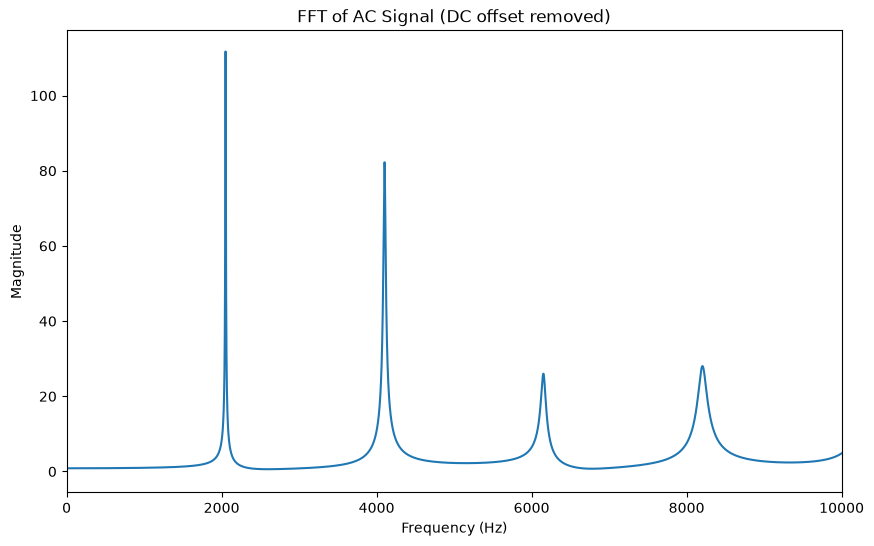
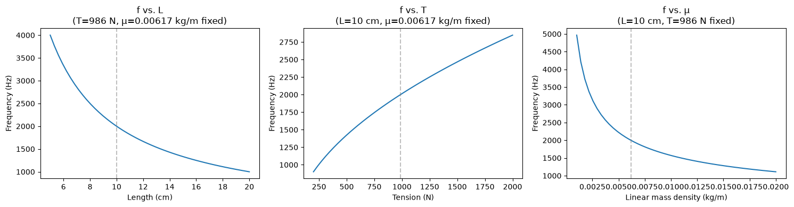

# Piano String Inverse Problem: Designing a 2 kHz Instrument

Design a piano string that sounds at 2 kHz, then synthesize it and check the frequency content with an FFT. This is a project for *Discrete Signals and Inverse Problems*.

The full writeup, with derivations, plots, and discussion, is in [`code/piano_simulation.ipynb`](code/piano_simulation.ipynb).

## Problem

> Design a musical instrument to produce a 2 kHz frequency sound. Understand the underlying physical processes and develop an analytical model to predict the resonant frequency of the instrument. Use the audio capabilities in your computer to digitize the signal and corroborate the frequency content. What is the shape of the signal? How can you alter the frequency?

## Approach

1. **Analytical model (inverse problem).** Model the piano string as an ideal string under tension, $f = \frac{1}{2L}\sqrt{T/\mu}$. Choose the length and material, then solve for the tension that produces $f_0 = 2$ kHz.
2. **Synthesis.** Generate the plucked-string sound with the Karplus–Strong algorithm (a noise-filled delay line with averaging feedback).
3. **Frequency content.** Remove the DC offset, take the FFT, and detect peaks to check the fundamental and the harmonic series.
4. **Signal shape and pitch.** Plot the waveform, map frequencies to the nearest musical note (with cents deviation), and compare the sound against a pure 2 kHz sine tone.
5. **Altering the frequency.** Sweep length, tension, and linear mass density to show how each one moves the pitch.

## Key Results

| Quantity | Value |
|---|---|
| String | Steel, ρ = 7850 kg/m³, d = 1 mm, L = 10 cm |
| Linear mass density μ | 0.00617 kg/m |
| Required tension T | **≈ 986 N** |
| Synthesized fundamental (FFT peak) | ≈ 2051 Hz (+2.55% vs. target) |
| Target note / generated note | B6 (+21.3 ¢) / C7 (−35.1 ¢) |

- The FFT shows clear peaks at near-integer multiples of the measured fundamental (~2051, ~4102, ~6150, ~8200 Hz), which matches the harmonic series of an ideal string.
- The 2.55% offset from the target comes from discretizing the Karplus–Strong delay line at a 44.1 kHz sample rate. See the notebook for details.
- The pitch rises with tension (∝ √T) and falls with length (∝ 1/L) and with linear density (∝ 1/√μ).





## Repository Structure

```
.
├── README.md
├── requirements.txt
├── figures/                     # plots used in this README
└── code/
    ├── piano_simulation.ipynb   # full writeup and analysis
    └── piano_string_utils.py    # helpers: string model, Karplus–Strong, FFT/peak detection, note conversion
```

## How to Run

Requires Python 3.13 (3.10+ should work).

```bash
git clone https://github.com/cvivere/piano_inverse_problem.git
cd piano_inverse_problem
pip install -r requirements.txt
jupyter notebook code/piano_simulation.ipynb
```

**Audio playback:** `sounddevice` depends on PortAudio. It is bundled on Windows and macOS. On Linux, install it with `sudo apt install libportaudio2`. The cells under *Testing the sound* need an audio output device. Everything else runs without one.

## Limitations

- Ideal-string model: it ignores inharmonicity from string stiffness, hammer strike position and velocity, and soundboard coupling.
- Karplus–Strong can only produce pitches set by a whole number of delay-line samples, so a precise target needs fractional-delay tuning (e.g., an allpass filter).

## References

1. *[Ideal string frequency source]*
2. Karplus, K., & Strong, A. (1983). Digital Synthesis of Plucked-String and Drum Timbres. *Computer Music Journal*, 7(2), 43–55.
3. *[Note/cents conversion source]*
